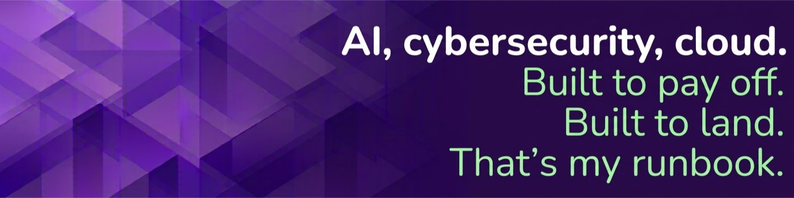

  

# Russell Dyas

> Deep enough to make the technical call. Commercial enough to make it pay off. Close enough to the customer to know it landed.

20+ years partnering with founders, CEOs and leaders across startups and scaleups. I can join at any stage, as the only technical person in a startup, into a small team in a scaleup or further along, and take the function to the next one. Today that means AI, InfoSec & Cybersecurity and cloud infrastructure: the parts of the business nobody notices until they break, and that customers feel long before a dashboard shows it.

I'm Head of Product Operations at [Rencore](https://www.rencore.com), where I built the department from scratch. It covers security, cloud infrastructure and our developer platform, and I lead how we use AI across all of it.

## What I work on

- AI: putting AI and AI agents to work across engineering, operations and security, with a clear view of where they help and where they don't
- InfoSec & Cybersecurity: security monitoring, identity and access, cloud security, pen testing and compliance
- Cloud Infrastructure: architecture decisions that shape performance, security and the monthly bill
- Technical Support, Ops & QA: keeping the systems customers depend on running when nobody's watching
- Build and Scale: joining a function at whatever stage it is at and growing it without it falling over
- Team Architecture: designing teams of people and AI agents that can carry all of the above

## Recent work

- Took the team from writing prompts to working with Claude every day, including AI agents that own whole pieces of work
- Led the rebuild of on-call. AI pulls in every part of the system when an issue arrives and hands engineers a diagnosis, often with the cause already found
- Built security monitoring on Microsoft Sentinel (log pipelines, normalisation, retention and KQL detections) where AI triages the alerts and a person checks anything it can't back up
- Run internal pen tests, using AI to find issues faster and cover more ground
- Made security part of how we ship software and infrastructure, with scanning built into our GitHub Actions and Azure DevOps pipelines
- Achieved SOC 2 and ISO 27001 with our Head of Compliance and Legal, designing the new processes and using AI to map controls and gather evidence
- Cut yearly cloud spend by 30% with an infrastructure redesign, and set up a FinOps practice with Finance
- Write security documentation for engineers, leaders and customers, and my team supplies much of the detail behind customer security questionnaires

## What I work with

Most of this lives in private company repos, so not much of it shows up here.

## Find me

I post on LinkedIn about AI, cybersecurity and growing technical functions at every stage, and on Instagram and TikTok about cyber and AI in plain English.
